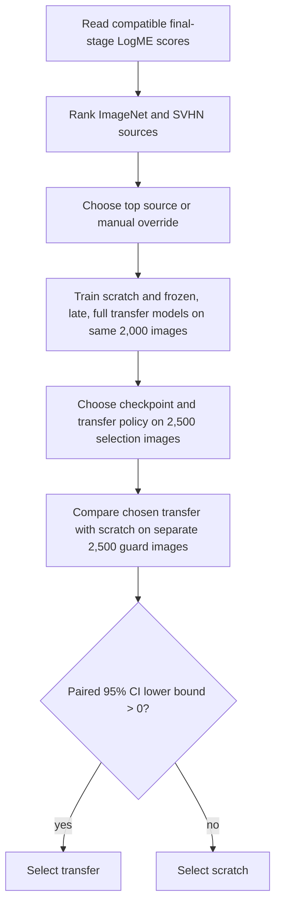

# Phase 5: selective transfer and validation guard

TransferGuard uses the existing TorchVision MobileNetV3-Small, Phase 1 CIFAR-10 subset, Phase 2 training loop, Phase 3 SVHN checkpoint loader, and Phase 4 LogME scores. It adds no architecture or loss function.

## Data and policies

The split is deterministic for a given seed. Phase 1 supplies 2,000 training and 5,000 validation indices from the official CIFAR-10 *training* partition. Each has equal class counts and no shared indices. Phase 5 divides the validation indices by class into 250 selection and 250 guard images per class, then shuffles each partition reproducibly. The guard images are evaluated only after all checkpoints and the transfer policy have been fixed. The official test partition is not loaded.

All three transfer candidates start from copies of one source model, including the same freshly initialized ten-class CIFAR-10 output layer. ImageNet starts from TorchVision weights; SVHN starts from a validated Phase 3 source checkpoint. The old SVHN digit output is replaced before the copies are made. `frozen` trains the classifier and keeps all feature blocks in evaluation mode. `late` trains feature blocks 9–12 and the classifier; blocks 0–8, including their BatchNorm statistics, stay frozen. `full` trains every parameter. The late boundary follows Phase 4's middle feature stage at block 8.

The scratch model and each candidate use the same training images, augmentations, epoch count, and selection images. Learning rates are configurable by policy. Each model's best checkpoint maximizes selection accuracy; ties keep the earlier checkpoint. The transfer policy with the highest best selection accuracy is chosen; policy order resolves exact ties. The scratch checkpoint is selected by the same rule.

## Scores and guard

Saved LogME runs must match the target dataset, split seed, training index and ordered-label hashes, image size, deterministic preprocessing, normalization, architecture, feature dimensions, and LogME variant. Final-stage scores rank the available pretrained sources; there is no absolute score threshold. A manual source override enables tests of potentially harmful transfer. An SVHN score must refer to the exact source checkpoint used for training, checked by SHA-256.

On the guard set, let `t_i` and `s_i` be indicators that transfer and scratch predict image `i` correctly. The paired accuracy difference is `d = mean_i(t_i - s_i)`. With a fixed seed, bootstrap samples draw image indices with replacement and recompute `d`; the 2.5th and 97.5th percentiles form a 95% percentile interval. The decision is transfer only when its lower endpoint is strictly greater than zero. Predictions are aligned on the same images. The guard set never chooses a checkpoint, learning rate, source, or policy.

## Run and interpretation

Run `python -m experiments.transferguard.run --help` for all options. The default 30-epoch experiment trains four MobileNetV3-Small models in sequence, roughly quadrupling target training cost versus one scratch run, plus validation and LogME scoring done previously. CUDA peak allocated memory and individual training times are recorded when available. `runs/transferguard/<unique-id>/` holds `config.json`, `summary.json`, and a directory per model with `metrics.csv` and `best_model.pth`. Runs are ignored by Git and earlier experiments are untouched.

The paired interval accounts for shared guard examples, but this is an empirical fallback on one validation split, not a guarantee of better test performance. Repeated seeds, source pretraining, hyperparameter choices, dataset shift, and the finite guard set can alter the result. LogME describes frozen feature suitability and need not predict fine-tuning outcomes. The guard result must not be reused for tuning or repeatedly choosing policies.
